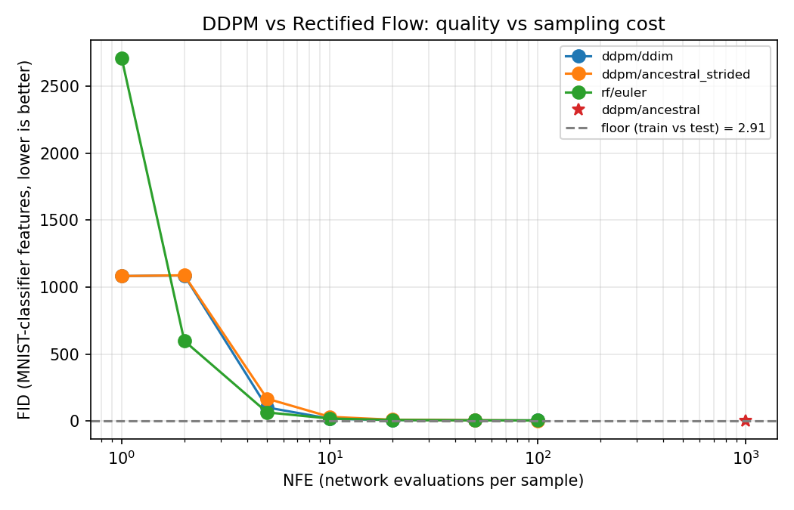
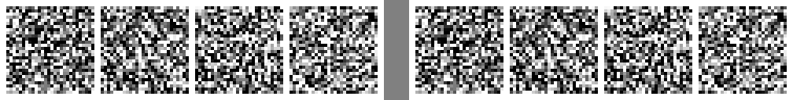
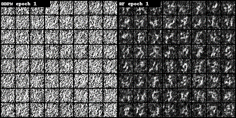

# mnist_flow

MNIST generative modelling: **DDPM vs rectified flow (RF)** with one small UNet.
Both models share the same architecture, data, optimizer and training budget; only the
training objective (noise vs. velocity prediction) and the sampler differ. Quality is
measured as a function of the number of network evaluations (NFE).

Start with the walkthrough: [`notebooks/demo.ipynb`](notebooks/demo.ipynb) (outputs included, never trains).

## Results

Evaluated at N=10,000 samples per row, EMA weights, one shared noise bank. Lower `fid` is better.
Models were trained on an NVIDIA H100 (torch 2.7, CUDA) at about 11 s/epoch.

| model | sampler | nfe | fid | coverage_entropy | mean_confidence |
|---|---|---|---|---|---|
| ddpm | ddim | 1 | 1083.29 | 1.297 | 0.659 |
| rf | euler | 1 | 2709.95 | 0.136 | 0.390 |
| ddpm | ddim | 2 | 1087.88 | 1.304 | 0.655 |
| rf | euler | 2 | 599.21 | 2.032 | 0.769 |
| ddpm | ddim | 5 | 102.44 | 2.277 | 0.893 |
| rf | euler | 5 | 65.45 | 2.276 | 0.906 |
| ddpm | ddim | 10 | 18.79 | 2.294 | 0.932 |
| rf | euler | 10 | 19.72 | 2.294 | 0.934 |
| ddpm | ddim | 20 | 8.61 | 2.296 | 0.943 |
| rf | euler | 20 | 9.22 | 2.297 | 0.946 |
| ddpm | ddim | 50 | 6.06 | 2.297 | 0.950 |
| rf | euler | 50 | 6.05 | 2.297 | 0.952 |
| ddpm | ddim | 100 | 5.60 | 2.296 | 0.952 |
| rf | euler | 100 | 5.29 | 2.298 | 0.954 |
| ddpm | ancestral | 1000 | 4.14 | 2.296 | 0.963 |
| real (train vs test) | floor | - | 2.91 | 2.299 | 0.981 |

The complete table (including the stochastic strided-ancestral DDPM rows) is in
[`results/metrics_table.md`](results/metrics_table.md); raw numbers in `results/metrics.json`.

- RF wins at 2 and 5 steps (599 vs 1088, 65 vs 102).
- DDPM-DDIM wins at 1 step (1083 vs 2710).
- The two are tied from 10 steps on: about 6.0 at 50 steps and 5.1-5.6 at 100.
- Real-data floor 2.91; DDPM ancestral at 1000 steps reaches 4.14.

Samples after every training epoch (same 64 noises, EMA weights; DDPM left, RF right):

## Fairness statement

Both models use the identical UNet (base 64 channels, multipliers 1-2-2, 2 residual blocks per level,
GroupNorm with 8 groups, 256-d time embedding, about 5.9M parameters), the same MNIST train split scaled
to [-1, 1], Adam optimizer with lr 2e-4, batch size 128, 20 epochs (9,360 steps), seed 0, and an EMA of
the weights with decay 0.999. The only configuration difference is `rf_time_sampling` (RF draws t uniformly),
which is exempt by construction; `evaluate.py` raises on any other checkpoint-config difference.
Evaluation uses EMA weights for both models, one shared noise bank (seed 1234, hash recorded in
`metrics.json`), one real reference set (MNIST test), one classifier, and the same N for every row.
DDPM uses a linear beta schedule from 1e-4 to 0.02 over T=1000.

## Metric definitions

- **fid** is a Frechet distance computed in the 128-d feature space of a small MNIST classifier trained
  by this repo (test accuracy is in `results/metrics.json` under `meta`, about 98.3%). It is **not** Inception FID and
  its numbers are not comparable with published FIDs.
- **coverage_entropy** is the entropy (nats) of the predicted-class histogram of generated samples;
  the maximum is ln 10 = 2.303 (perfectly balanced classes).
- **mean_confidence** is the classifier's mean top-class probability on generated samples.
- **floor** is the same fid between 10,000 MNIST train and the test images, the best a perfect generator could expect.

## Setup and tests

    uv venv .venv && uv pip install --python .venv/bin/python -e ".[dev]"
    .venv/bin/python -m pytest -q
    .venv/bin/python -m pytest -q --cov=src/mnist_flow

Tests run on CPU and never download MNIST.

## Train locally

    .venv/bin/python -m mnist_flow.train --model ddpm --epochs 20
    .venv/bin/python -m mnist_flow.train --model rf --epochs 20
    .venv/bin/python -m mnist_flow.train --model rf --tiny      # smoke test

Checkpoints go to `checkpoints/<model>/`, per-epoch losses to `runs/train_<model>.json`
(`--sample-every N` also writes sample grids).

## Evaluate and sample

    .venv/bin/python -m mnist_flow.evaluate --ckpt-dir checkpoints --out results --n 10000
    .venv/bin/python -m mnist_flow.sample --ckpt checkpoints/rf/final.pt --sampler euler --steps 20

## Run on Lambda

See [`cloud/README.md`](cloud/README.md) for the launch, sync, run, pull and terminate sequence and the cost ledger.

## Layout

    src/mnist_flow/   unet, ddpm, rf, ema, train, sample, evaluate, classifier, metrics, plots, trajectory, epoch_viz
    tests/            CPU unit tests
    cloud/            Lambda launch/sync/run scripts
    notebooks/        demo.ipynb (executed, outputs kept)
    results/          metrics.json, metrics_table.md, figures/, samples/
    runs/             per-epoch training logs
    runs_viz/         per-epoch sample grids and GIFs
    checkpoints/      final.pt per model (EMA weights inside)

## Known limitations

- This is plain 1-rectified flow without reflow or distillation, so it is weak at 1-2 NFE.
- Inception FID is not computed; fid is a classifier-feature Frechet distance (see above).
- Only 20 epochs of training per model, one seed, so small differences (for example the ties from 10 steps on) should not be over-read.
